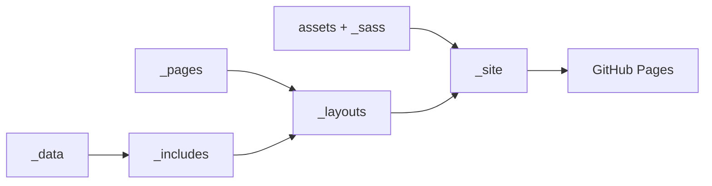

# Siyou Guo — Academic Homepage

[](https://siyouguo.github.io)
[](LICENSE)
[](https://jekyllrb.com/)

A single-page academic profile at [siyouguo.github.io](https://siyouguo.github.io), built with Jekyll and hosted on GitHub Pages.

## Architecture



## Layout

| Path | Purpose |
| --- | --- |
| `_data/` | News, publications, navigation |
| `_pages/about.md` | Homepage content |
| `_includes/`, `_layouts/` | Components and page composition |
| `_sass/`, `assets/css/main.scss` | Styling |
| `assets/js/main.min.js` | Deployed script bundle |
| `google_scholar_crawler/` | Citation scraper |

## Develop

Ruby 3.3+, Bundler, Python 3.

```bash
BUNDLE_PATH=.bundle/vendor bundle install
./run_server.sh
```

`assets/js/_main.js` and `assets/js/plugins/` are reference sources; only `main.min.js` is deployed.

## Maintain

- Profile and links: `_config.yml`, `_pages/about.md`
- News: `_data/news.yml`
- Publications: `_data/publications.yml`
- Citation count: run `cd google_scholar_crawler && python3 main.py`, then push the generated JSON to the orphan `google-scholar-stats` branch
- Deployment: push to `main`; GitHub Pages builds automatically

MIT license. See [LICENSE](LICENSE).
