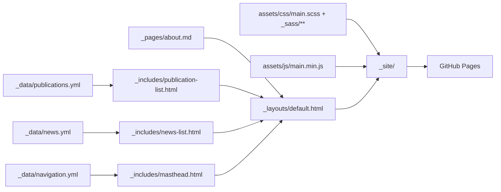

# Siyou Guo — Academic Homepage

[](https://siyouguo.github.io)
[](LICENSE)
[](https://jekyllrb.com/)
[](https://pages.github.com/)

A single-page academic profile built with Jekyll and published through GitHub Pages at [siyouguo.github.io](https://siyouguo.github.io). It presents research output, news, and a bilingual introduction, with a citation badge fed by Google Scholar.

The implementation is a customized Minimal Mistakes theme. Content is separated from presentation: publications and news live in structured data files, while layout and styling stay in `_includes/`, `_layouts/`, and `_sass/`.

## Architecture



The generated site contains one primary page (`/`). `about.md` provides the introduction and includes the News and Publications sections; `default.html` composes the head, masthead, sidebar, content, footer, and scripts. Jekyll compiles SCSS into `assets/css/main.css` and copies static assets into `_site/`.

## Repository layout

| Path | Purpose |
| --- | --- |
| `_config.yml` | Site metadata, plugin list, build exclusions |
| `_data/` | Structured content: navigation, news, publications |
| `_includes/` | Reusable HTML fragments |
| `_layouts/default.html` | Page composition |
| `_pages/about.md` | Homepage content and citation badge |
| `_sass/` | Theme SCSS partials and vendor styles |
| `assets/css/main.scss` | SCSS entry point and site-specific styles |
| `assets/js/main.min.js` | Deployed JavaScript bundle |
| `assets/js/_main.js`, `assets/js/plugins/` | Reference sources; excluded from the build |
| `assets/pdf/`, `images/` | Papers, figures, portraits, logos, icons |
| `google_scholar_crawler/` | stdlib-only citation scraper |
| `run_server.sh` | Local development server |

## Local development

Prerequisites: Ruby 3.3+ with Bundler, Python 3 for the citation crawler. On macOS, the development script prefers the Homebrew `ruby@3.3` installation.

```bash
# Install dependencies into a project-local path.
BUNDLE_PATH=.bundle/vendor bundle install

# Start the server at http://127.0.0.1:4000.
# Jekyll 3.x rebuilds on change; refresh the browser manually.
./run_server.sh
```

`run_server.sh` selects the Homebrew Ruby and uses the system certificate chain. The latter is required because `jekyll-github-metadata` contacts the GitHub API during builds, and newer Ruby HTTP clients fail certificate verification behind a local TLS proxy.

## Editing content

| To change | Edit |
| --- | --- |
| Name, biography, links, Scholar flag | `_config.yml`, `_pages/about.md` |
| Navigation labels and anchors | `_data/navigation.yml` |
| News entries | `_data/news.yml` |
| Publications | `_data/publications.yml` |
| Visual styling | `assets/css/main.scss`, relevant partials in `_sass/` |

To add a publication, place its PDF in `assets/pdf/` and its figure in `images/publications/`, then append an entry to `_data/publications.yml`. The list component renders entries in file order.

## Citation badge

Google Scholar blocks datacenter IPs, so citation counts are refreshed manually from a local machine. There is no scheduled CI job and no third-party proxy in the default path.

```bash
cd google_scholar_crawler
python3 main.py
```

The script writes `results/gs_data.json` and `results/gs_data_shieldsio.json`; both are ignored by Git. The badge reads `gs_data_shieldsio.json` from the orphan `google-scholar-stats` branch. To publish an update:

```bash
tmp=$(mktemp -d) && cp results/*.json "$tmp/" && cd "$tmp"
git init && git add *.json && git commit -m "Updated Citation Data"
git push git@github.com:siyouguo/siyouguo.github.io.git HEAD:google-scholar-stats --force
```

The force push is intentional: that branch contains only the two JSON files. Set `google_scholar_stats_use_cdn: true` in `_config.yml` to read the badge through jsDelivr instead of `raw.githubusercontent.com`; the CDN may cache stale data.

## Deployment

Pushes to `main` are built and published automatically by GitHub Pages. No custom Actions workflow is used. Verify a change locally with `bundle exec jekyll build` before pushing.

## Notes

- `assets/js/main.min.js` is the only deployed script bundle. It already contains jQuery and the required plugins. Editing `assets/js/_main.js` or files under `assets/js/plugins/` does not affect the live site unless the bundle is regenerated.
- `google_scholar_crawler/main.py` and `_pages/about.md` each contain the Scholar ID. Keep them consistent when changing accounts.
- The Atom feed is generated but currently empty because the site has no dated posts.

## License

MIT. See [LICENSE](LICENSE).
